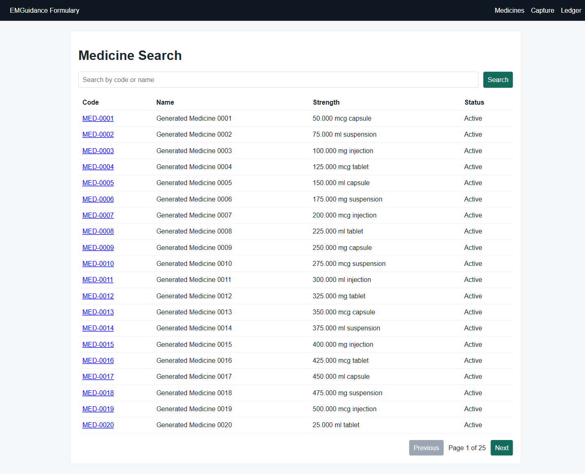
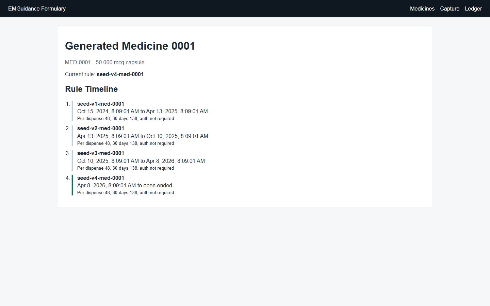
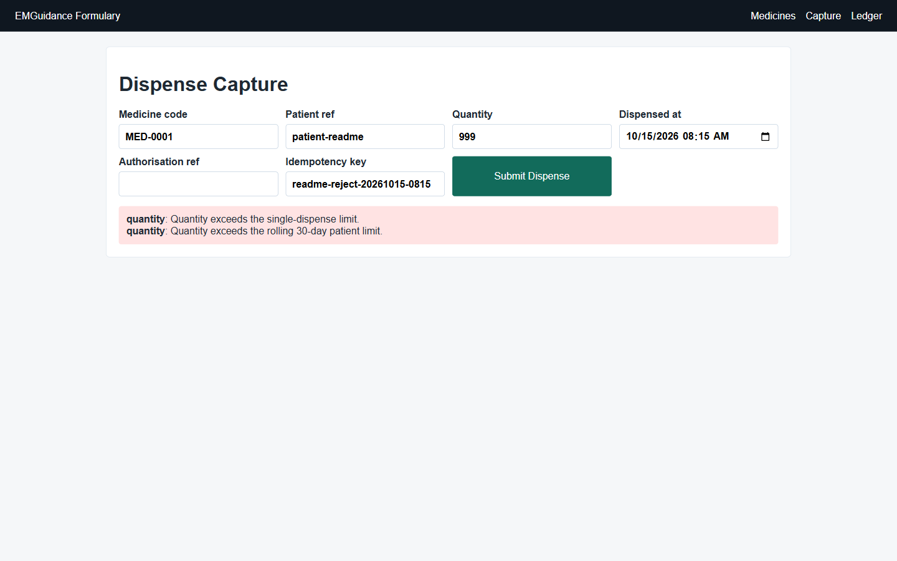
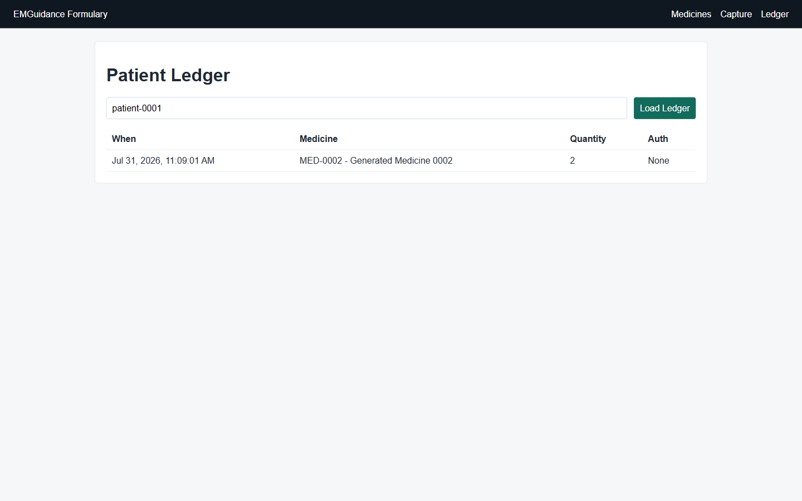

# Technical Assessment

Full-stack formulary and dispensing system for the EMGuidance assessment.

## Run The System

Start everything from a clean clone:

```bash
docker compose up --build
```

Docker starts:

- Angular frontend: `http://localhost:4200`
- FastAPI backend: `http://localhost:8000`
- OpenAPI docs: `http://localhost:8000/docs`
- PostgreSQL: `localhost:5432`

Migrations apply automatically when the backend container starts.

## Seed The Database

Load the required assessment dataset:

```bash
docker compose exec backend python scripts/seed.py
```

The seed command creates:

- 500 medicines
- 3 to 5 historical formulary rule periods per medicine
- 2,000 dispenses across 2,000 opaque patient references over a two-year window

Useful seeded examples:

- Medicine search: `MED-0001`
- Patient ledger: `patient-0001`

## Application Outputs

The screenshots below were captured from the Dockerized application after running the seed command.

| View | Output |
| --- | --- |
| Medicine search with paginated seeded catalogue |  |
| Medicine detail with historical formulary rule timeline |  |
| Dispense capture showing all validation failures returned together |  |
| Patient ledger filtered by seeded patient reference |  |

## Run Tests

Run backend tests inside the container:

```bash
docker compose exec backend pytest
```

Run the Angular production build:

```bash
docker compose exec frontend npm run build
```

## Measure Listing Performance

After seeding, run a simple local timing loop from the host:

```bash
curl -w "medicines %{time_total}s\n" -o NUL -s "http://localhost:8000/api/v1/medicines?page=1&page_size=25"
curl -w "dispenses %{time_total}s\n" -o NUL -s "http://localhost:8000/api/v1/dispenses?page=1&page_size=25"
```

On PowerShell, replace `NUL` with `$null` if needed.

## Project Structure

```text
Technical-Assessment/
|-- backend/        FastAPI, SQLAlchemy, Alembic, tests, and seed command
|-- docs/           README screenshots captured from the running Docker stack
|-- frontend/       Angular TypeScript application with the four required views
|-- ARCHITECTURE.md One-page system overview
|-- DECISIONS.md    ADR-style design choices and trade-offs
|-- AI_USAGE.md     AI tooling disclosure
|-- docker-compose.yml
`-- README.md
```

